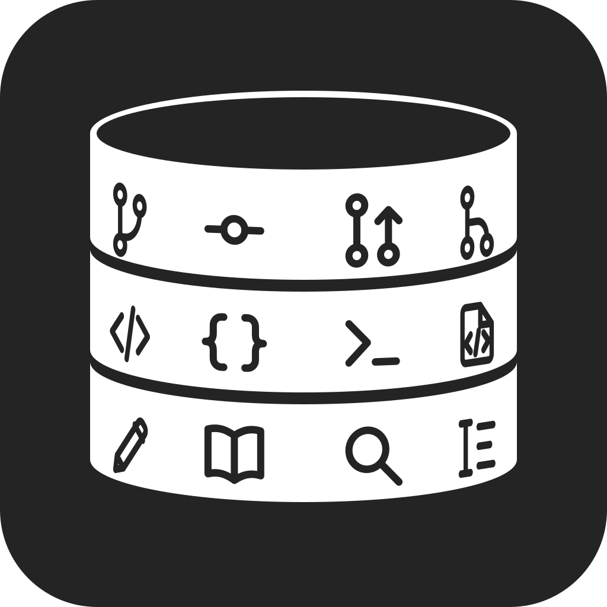

<h1 align="left">
  
  <br>
  Gitorian
</h1>

Turn your week's work into a journal you can return to.

Gitorian is a desktop journal for developers. Review your Git commits, GitHub and GitLab pull requests, and code reviews, then write about what you built and learned, with links back to the work. Autosave entries locally, search previous writing, and optionally publish to Notion.

[Download for Windows](https://github.com/XII-A/gitorian/releases/latest) · [Read the user guide](docs/user-guide.md) · [Report a bug or request a feature](https://github.com/XII-A/gitorian/issues)

## Downloads

Gitorian is an early app, with installers for **Windows 10/11 x64**. Open the [latest release](https://github.com/XII-A/gitorian/releases/latest), download the `.exe` installer under **Assets**, and run it. The source code archives are for development.

Installers are currently unsigned, so Windows or your browser may display a warning.

Packaged Windows installs support in-app updates. When an update is ready, choose **Update now** to save your writing, install, and restart. Back up your journal before updating.

macOS and Linux packaging is available for development; published installers currently target Windows.

## Write your first entry

1. **Install Git.** Download [Git](https://git-scm.com/downloads) if you don't already have it, and make sure it's available on your `PATH`.
2. **Add repositories.** Open **Settings > Repositories**, choose the folder containing your local Git repositories, and select the ones to track.
3. **Start writing.** Open a week, review the activity and diffs, and write an entry. Drafts save locally as you work.

Connect GitHub or GitLab in **Settings > Connections** for pull requests and reviews to complete onboarding. Notion publishing is optional. See the [user guide](docs/user-guide.md) for images, repository settings, and integration setup.

## Your data and connections

Your journal lives on your computer. Gitorian has no app-operated journal storage or analytics service. The local journal database is **not encrypted**, so treat it and its backups as private.

- **GitHub is optional.** It adds pull requests and reviews from GitHub.com. Sign-in requests a broad `repo` permission that includes write access, although Gitorian's current GitHub integration only reads activity and diffs.
- **Notion is optional.** Publishing sends your entry, images, and citations to your chosen Notion destination. A hosted OAuth helper handles sign-in and credential refresh; journal content travels directly from the desktop to Notion.
- **Backups are manual.** Use **Settings > Backup** to export your journal. Importing a backup replaces the journal on that device. Local drafts do not sync between devices.

Read the [data storage and privacy details](docs/user-guide.md#data-storage-and-privacy), [integration permissions](docs/user-guide.md#integration-setup-and-permissions), and [known limitations](docs/user-guide.md#known-limitations) before connecting work accounts or restoring a backup.

## For developers

Gitorian uses Electron, React, TypeScript, and SQLite. To run it locally, install **Node.js 24.16 or newer**, **pnpm 10.24.0**, and Git:

```sh
git clone https://github.com/XII-A/gitorian.git
cd gitorian
pnpm install --frozen-lockfile
pnpm dev
```

Run `pnpm check` for type, lint, formatting, and test checks, and `pnpm build` for a production build. Development uses the application data directory too; back up an existing journal before experimenting with storage changes.

See the [development guide](docs/development.md) for build and release instructions, [frontend conventions](docs/frontend.md) for UI work, and [Notion OAuth setup](docs/notion-oauth.md) for integration development.

## Feedback and license

[Report bugs and suggest features on GitHub Issues](https://github.com/XII-A/gitorian/issues). Remove tokens, private repository details, journal content, and personal information from reports and screenshots. Do not attach your journal backup or application data directory.

Gitorian is MIT licensed. See [LICENSE](LICENSE) and [NOTICE](NOTICE) for bundled component attribution.
